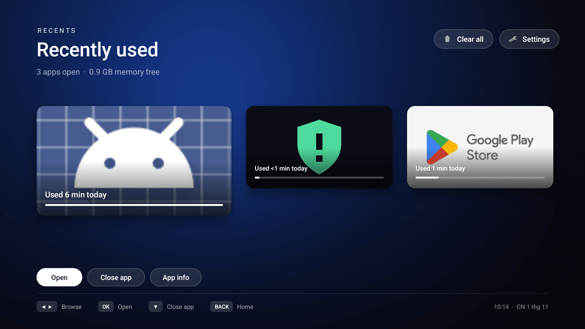
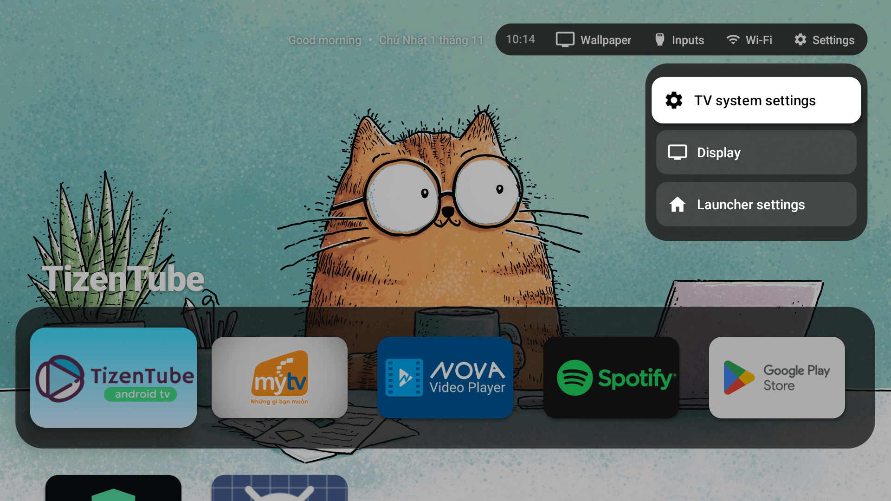
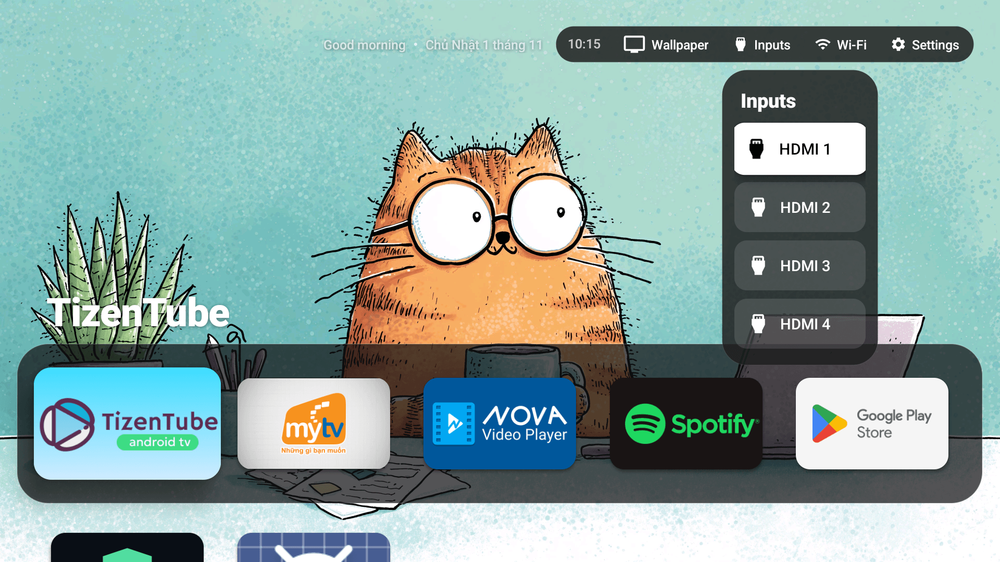

# 🎮 Dynamic Remote Button Mapping & Gestures Guide

Tài liệu này hướng dẫn chi tiết cách thức cấu hình phím bấm điều khiển từ xa (Remote Controller), cơ chế xử lý sự kiện phần cứng không độ trễ, và các cử chỉ điều hướng trong **Apple TV Launcher**.

---

## ⚡ 1. Nguyên lý bảo toàn phần cứng (Hardware Preservation)

Các ứng dụng gán phím thông thường (như Button Mapper, tvQuickActions) thường chặn toàn bộ sự kiện bàn phím qua lớp `AccessibilityService`. Khi người dùng giữ phím tăng/giảm âm lượng, dịch vụ Accessibility sẽ nuốt sự kiện, phá vỡ bộ đếm gia tốc phần cứng `InputDispatcher` của nhân Linux/Android, gây ra hiện tượng **trễ âm lượng (volume lag)** hoặc âm lượng tăng giật cục.

> [!IMPORTANT]
> **Triết lý Zero-Lag của Apple TV Launcher:**
> `HomeKeyService` chỉ lắng nghe và can thiệp **đúng các phím được cấu hình cụ thể** (phím Home, phím chức năng tùy chọn). Mọi phím điều hướng (D-Pad Up/Down/Left/Right/Center), phím Back, và đặc biệt là phím **Volume Up / Down** đều được chuyển thẳng qua hệ điều hành ở tầng phần cứng, bảo tồn 100% tốc độ lặp phím tự nhiên.

---

## 🎯 2. Các hành động hỗ trợ gán phím (Supported Actions)

Trong tệp cấu hình `config.json`, bạn có thể gán bất kỳ mã phím nào (`keyCode`) tới các hành động hệ thống sau:

| Tên Action | Mô tả chức năng | Giao diện kích hoạt |
|---|---|---|
| `wallpaper_cycle` | Chuyển ngay sang hình nền 4K tiếp theo với hiệu ứng 400ms crossfade và banner kính mờ | Top-Left Glass Banner |
| `quick_settings` | Bật/tắt thanh trung tâm điều khiển Control Center / Quick Settings | Platter trượt từ cạnh phải |
| `inputs` | Bật/tắt menu chuyển đổi cổng tín hiệu TV (HDMI 1, HDMI 2, AV...) | Popup danh sách đầu vào |
| `recent_apps` | Mở giao diện đa nhiệm Recent Apps Switcher tvOS | Carousel thẻ ứng dụng đang chạy |

---

## 📂 3. Cấu hình phím động trong `config.json`

Cấu trúc định nghĩa trong file cấu hình người dùng:

```json
{
  "remote_keys": {
    "170": "quick_settings",
    "178": "inputs",
    "229": "wallpaper_cycle"
  }
}
```

### Cách xác định Keycode của nút bấm trên Remote TV:
Để biết nút bấm trên điều khiển từ xa của bạn phát ra mã số nào, kết nối ADB và quan sát logcat khi bấm phím:
```bash
adb logcat -s AppleTv.HomeKey
```
Logcat sẽ hiển thị sự kiện nhận diện:
```
AppleTv.HomeKey: onKeyEvent: keyCode=229 action=0
```
Sau đó bạn chỉ cần thêm mã số đó vào phần `remote_keys` trong file cấu hình.

---

## 🖐️ 4. Cử chỉ mặc định (Default Gestures)

### 1. Nhấn đúp phím Home (Double-Press Home ➔ Recent Apps Switcher):
- Nhấn phím **Home** 2 lần liên tiếp (trong khoảng 1200ms) từ bất cứ màn hình nào để gọi ngay **Recent Apps Switcher** mang phong cách tvOS.
- Cho phép xem nhanh danh sách các ứng dụng vừa mở, chuyển đổi tức thì hoặc đóng ứng dụng chạy ngầm.

<p align="center">
  
</p>
<p align="center"><em>Recent Apps Switcher dạng thẻ trực quan (Double-Press Home)</em></p>

### 2. Trung tâm điều khiển (Control Center / Quick Settings):
- Nhấn nút Cài đặt trên remote (hoặc biểu tượng trên menu) để mở thanh điều khiển nhanh.
- Cho phép truy cập nhanh Wi-Fi, hẹn giờ ngủ, chế độ hình nền, bộ chọn hình nền và cài đặt launcher.

<p align="center">
  
</p>
<p align="center"><em>Thanh Control Center dạng Platter kính mờ</em></p>

### 3. Bộ chọn cổng đầu vào (TV Inputs Switcher):
- Nhấn nút Input/Source trên remote để bật menu chọn cổng HDMI/TV nhanh chóng mà không cần thoát khỏi launcher.

<p align="center">
  
</p>
<p align="center"><em>Menu chuyển đổi cổng tín hiệu HDMI / AV</em></p>
