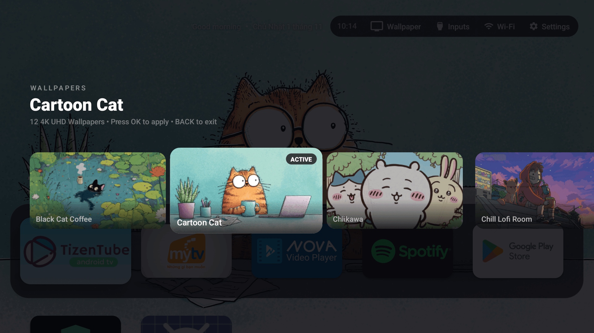
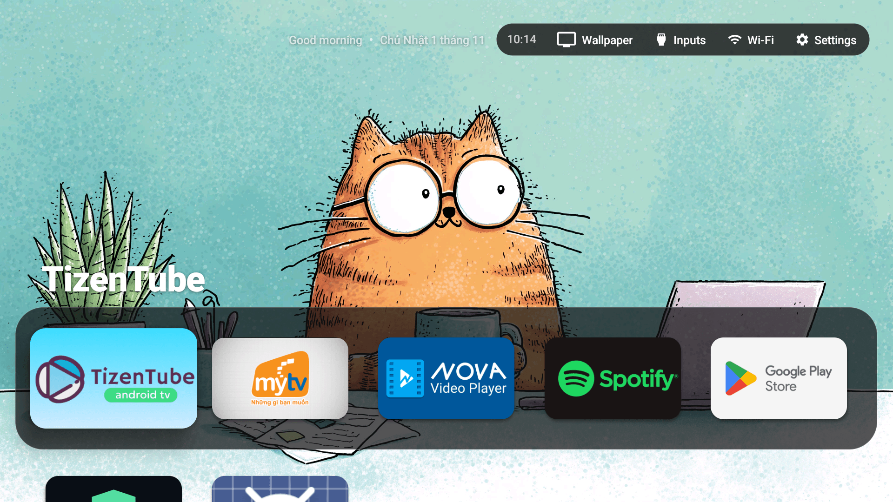

# 🖼️ Android TV Wallpaper System Specification & Sync Guide

Tài liệu này ghi lại chi tiết toàn bộ thông số kỹ thuật phần cứng TV, kiến trúc xử lý hình nền trong launcher, giao diện bộ chọn hình nền tvOS 18 và quy trình chuẩn hoá - đồng bộ ảnh 4K tự động.

---

## 📺 1. Thông số thiết bị TV (Hardware & Display Profile)

| Thuộc tính | Giá trị chi tiết | Ghi chú kỹ thuật |
|---|---|---|
| **Thương hiệu & Model** | TCL Smart TV Pro (`G08`) | Chipset / Board: `merak` (MediaTek MT9618 / tcl9618) |
| **Hệ điều hành** | Google TV — Android 14 (API 34) | Kernel Linux, bảo mật 2025-12-05 |
| **Địa chỉ ADB mặc định** | `192.168.1.10:5555` | Port ADB qua mạng LAN |
| **Độ phân giải màn hình vật lý** | **3840 × 2160** (4K UHD) | Tấm nền 4K tỉ lệ 16:9 |
| **Độ phân giải UI Override** | `1920 × 1080` (Density: 320 dpi) | Android TV render khung UI ở 1080p |
| **Bộ nhớ (RAM)** | Total: ~2.4 GB, Available: ~800 MB | Giới hạn RAM TV cần tối ưu tránh OOM |
| **Bộ nhớ trong (Storage)** | Flash: 48 GB trống | Lưu trữ thoải mái cho bộ sưu tập 4K |

---

## ⚙️ 2. Kiến trúc Wallpaper trong Apple TV Launcher

### 📂 Đường dẫn lưu trữ:
- **Thư mục ảnh nền trên TV**: `/sdcard/Android/data/com.appletv.launcher/files/wallpapers/`
- **Ảnh nền đang kích hoạt (Active)**: `/sdcard/Android/data/com.appletv.launcher/files/wallpaper.jpg`
- **Thư mục local trên repo**: `./wallpapers/` *(đã cấu hình `.gitignore`)*

### 📐 Ràng buộc mã nguồn & Giới hạn an toàn (Code Constraints):
1. **`WallpaperSize.MAX_PIXELS = 8_400_000L`**:
   - Chuẩn 4K UHD: $3840 \times 2160 = 8,294,400\text{ px} \le 8,400,000$.
   - **Cảnh báo**: Nếu ảnh có kích thước lớn hơn 8.4M px (ví dụ file ảnh gốc `4072 × 2280 = 9.28M px`), hàm `WallpaperSize.accepted(...)` sẽ trả về `false`, buộc hệ thống phải nhảy `inSampleSize = 2`. Khi đó ảnh bị giảm độ phân giải xuống còn 1080p khi decode, gây mờ và lãng phí chất lượng tấm nền 4K!
2. **Định dạng JPEG chuẩn hoá thay vì PNG**:
   - Ảnh 4K dạng PNG không nén chiếm từ 10 MB - 25 MB, gây nghẽn băng thông ADB và tốn RAM giải mã trên TV.
   - Chuẩn hoá sang **JPEG (MozJPEG chất lượng 90–92%)** giữ dung lượng trong khoảng **1.0 MB – 1.6 MB** mà mắt thường không thể phân biệt được với ảnh gốc.
   - Script nền xoay wallpaper định kỳ `rotate_daily.sh` trên TV quét danh sách theo pattern:
     ```sh
     FILES=$(ls "$WALLPAPERS_DIR"/*.jpg 2>/dev/null | sort)
     ```
     Do đó, định dạng `.jpg` là bắt buộc để daemon nhận diện chính xác.
3. **Bộ nhớ Thumbnail Grid (`WallpaperPickerAdapter.java`)**:
   - Grid picker tvOS 18 sử dụng LruCache tối đa 4 MB (decode thumbnail xuống 320×180 px định dạng `RGB_565`, chiếm ~115 KB/ảnh) tránh gây hiện tượng tràn bộ nhớ (Out-Of-Memory).

---

## 🎨 3. Giao diện Bộ chọn hình nền trực quan (Visual Wallpaper Grid Picker)

Bộ chọn hình nền được thiết kế theo chuẩn **tvOS 18 Liquid Glass**:
- Hiển thị danh sách ảnh nền dạng thẻ lưới ngang (Horizontal Card Carousel).
- Viền sáng trọng tâm tương tác thực (tvOS Glow Focus Ring) phản hồi mượt mà theo D-Pad remote.
- **Tự động focus & căn giữa vào hình nền đang áp dụng**: Lưu vết `wallpaper_active_name` vào `SharedPreferences`, khi mở popup bộ chọn sẽ tự cuộn và đặt con trỏ vào đúng ảnh hiện tại.
- Kích hoạt qua Control Center / Quick Settings hoặc intent ADB:
  ```bash
  adb shell am start -n com.appletv.launcher/.MainActivity -a com.appletv.launcher.action.SHOW_WALLPAPERS
  ```

<p align="center">
  
</p>
<p align="center"><em>Giao diện Wallpaper Grid Picker với LruCache và viền sáng tvOS</em></p>

---

## ⚡ 4. Đổi hình nền 1 chạm & Banner thông báo Glass (Remote Cycling)

Người dùng có thể gán phím cứng trên remote (hoặc phím tắt) để chuyển ảnh nền kế tiếp ngay tức thì:
- Hiệu ứng chuyển cảnh mượt mà **400ms crossfade**.
- **Top-Left Glass Banner**: Banner thông báo tên hình nền xuất hiện ở góc trên bên trái với hiệu ứng kính mờ (frosted glass), đồng bộ giao diện với thanh menu trạng thái (Status Bar) tvOS 18.
- Kích hoạt qua intent ADB:
  ```bash
  adb shell am start -n com.appletv.launcher/.MainActivity -a com.appletv.launcher.action.CYCLE_WALLPAPER
  ```

<p align="center">
  
</p>
<p align="center"><em>Banner kính mờ hiển thị tên hình nền ở góc trên bên trái</em></p>

---

## 🌟 5. Tuỳ chọn Ambient Glow (`ambient_glow`)

Mặc định trên một số launcher, màu nhấn (accent color) của icon ứng dụng đang focus sẽ tạo ra một quầng sáng mờ (radial ambient glow) lan tỏa ra toàn bộ nền. Tuy nhiên, điều này làm cho ảnh nền 4K bị ám màu cục bộ, mất đi độ sâu màu đen và độ tương phản gốc của hình nền.

- Thêm thuộc tính `ambient_glow` trong `config.xml` / `Config.java` (mặc định: `false`).
- Giúp giữ nguyên vẹn 100% màu sắc trung thực, độ sâu và độ trong của các tác phẩm nghệ thuật 4K.

---

## 🛠️ 6. ADB Transfer Quirk trên Android TV (Lưu ý quan trọng)

Hệ thống tập tin `/sdcard` trên Android TV chạy qua lớp FUSE/sdcardfs.
> [!WARNING]
> Nếu chạy trực tiếp `adb push <file> /sdcard/...`, ADB sẽ cố gắng thực hiện `fchown` để giữ permission của host và bắn ra lỗi:
> ```
> remote fchown failed: Operation not permitted
> ```

**Giải pháp an toàn (2-step stage push)**:
Đẩy file trung gian vào `/data/local/tmp/`, sau đó dùng `cp` sang `/sdcard/...` và xoá file tạm:
```bash
adb push image.jpg /data/local/tmp/image.jpg
adb shell "cp /data/local/tmp/image.jpg /sdcard/Android/data/com.appletv.launcher/files/wallpapers/image.jpg && rm -f /data/local/tmp/image.jpg"
```

---

## 🚀 7. Công cụ tự động hoá 1-Click: `tools/sync_wallpaper.sh`

Repository đã tích hợp sẵn công cụ tự động xử lý và đồng bộ ảnh:

```bash
./tools/sync_wallpaper.sh <đường_dẫn_ảnh> [TV_IP]
```

### Ví dụ sử dụng:
```bash
# Tự động crop/scale sang 3840x2160 JPEG q=92 và đồng bộ lên TV 192.168.1.10:5555:
./tools/sync_wallpaper.sh wallpapers/New_Wallpaper.png
```

### Các bước script tự động thực hiện:
1. Xoá metadata download rác của Windows WSL (`:Zone.Identifier`).
2. Tự động crop trung tâm (center-crop) và phóng/thu về chuẩn **3840×2160 (16:9 4K UHD)**.
3. Nén MozJPEG chất lượng cao (quality 92, chroma subsampling 4:2:0) bằng engine `sharp` (Node.js) hoặc fallback sang `ImageMagick` / `ffmpeg`.
4. Đẩy file qua `/data/local/tmp/` vào TV để tránh lỗi FUSE `fchown`.
5. So sánh mã băm MD5 giữa máy tính và TV để đảm bảo toàn vẹn dữ liệu.
6. Xoá file gốc định dạng khác trong `wallpapers/` nếu có, tránh tạo card trùng tên trong menu TV.
